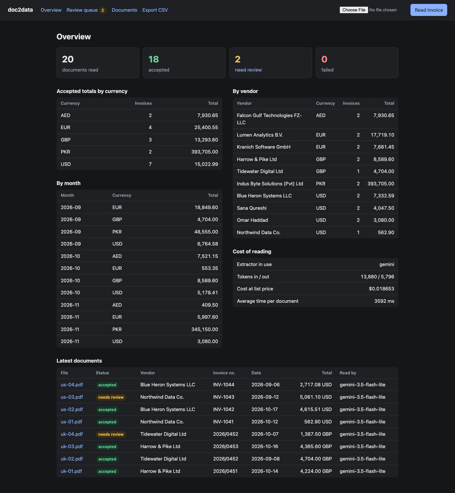
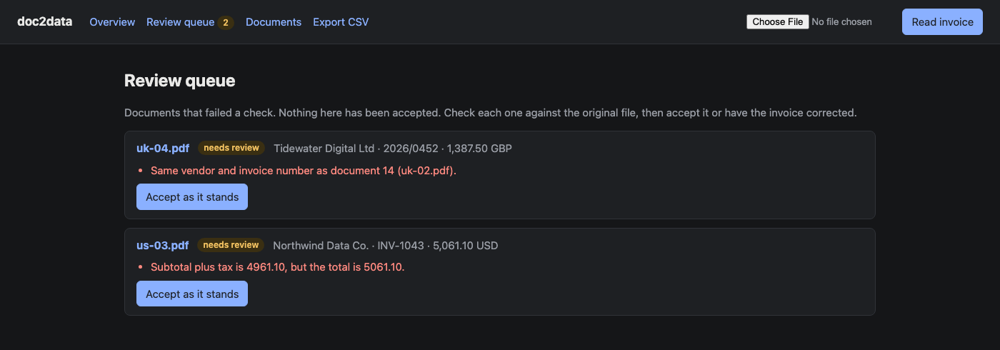
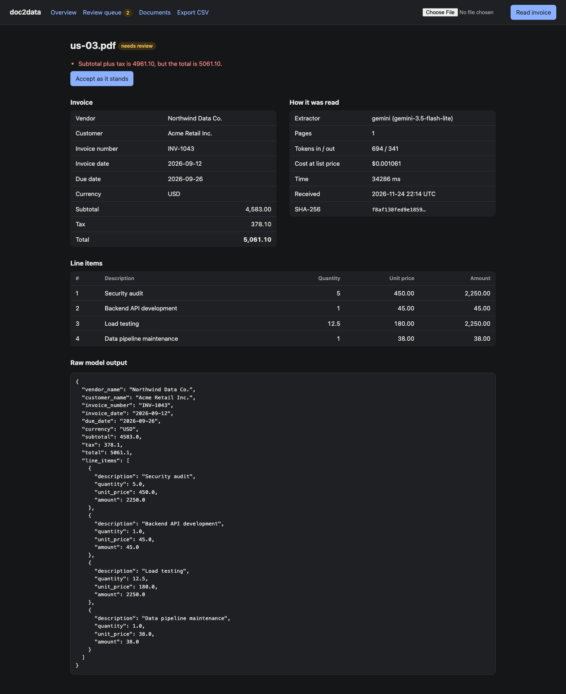

# doc2data

Turns invoices into data you can rely on. Each PDF is read, checked, and then either accepted or sent to a person with the reason it was held back.

Reading an invoice with a model takes one API call. The work is in knowing when the answer is wrong. An extractor that is right 95% of the time still puts one invoice in twenty into your books with the wrong vendor, date or amount, and nobody finds out until a payment goes astray. This project is built around catching that.



## What it does

- **Reads** a PDF into a structured invoice: vendor, customer, number, dates, currency, amounts and line items.
- **Checks** it without trusting the extractor: totals must add up, line items must add up, dates must make sense, and the same invoice number from the same vendor is not booked twice.
- **Decides**: a document is `accepted`, `needs_review` with the failed check spelled out, or `failed` with the error. Nothing is dropped silently.
- **Skips** a file the same extractor has already read (matched by content hash), and retries one that failed.
- **Records** what each read cost: tokens, list-price cost, time, and the raw model output.
- **Shows** the result in a dashboard with a review queue, a JSON API and a CSV export.
- **Measures** any extractor against labelled samples, including how many wrong documents got past the checks.

## Results on the bundled samples

The repository includes 20 synthetic invoices in five layouts (US, EU, UK, a freelancer's prose invoice, and Pakistan/Gulf), with ground truth. They differ in the ways that break extraction: date order, decimal marks, label wording, and where the vendor's name sits. Two are wrong on purpose. Every name, address and number in them is invented.

| Measure | Rules only | Gemini |
|---|---|---|
| Fields correct | 86.0% | 100.0% |
| Documents with every field correct | 10 of 20 | 20 of 20 |
| Documents wrong on a critical field | 6 of 20 | 0 of 20 |
| ...caught by the checks and sent to review | 1 | 0 |
| ...accepted without anyone noticing | 5 | 0 |
| Cost at list price, all 20 documents | $0 | $0.019 |

**Rules only** is regular expressions with no model. The rules read the US and Pakistan/Gulf layouts perfectly, then got five documents wrong in ways no check could see:

- All four EU invoices were booked to the customer instead of the vendor, because the vendor's name appears only in the footer.
- One UK invoice dated `08/09/2026` (8 September) was read month-first as 9 August.

In all five the totals were right, so the arithmetic checks had nothing to catch. Full report: [eval/rules.md](eval/rules.md). A test pins these figures, so the table cannot drift from the code.

**Gemini** is `gemini-3.5-flash-lite`, run on 24 November 2026 (UTC) with a free-tier key. It read every field of all 20 invoices correctly, the five above included ([eval/gemini.md](eval/gemini.md)), and three later passes over the same files gave the same result; the screenshots below come from the last of them. It also copied the deliberately wrong total as printed rather than quietly fixing it, so the check still caught that invoice.

Twenty clean synthetic invoices are an easy test, and a model's answers can change from one run to the next. The column to look at is the left one: it shows what slips through when nothing measures it. The same command measures any extractor on your own labelled documents.

### Scanned pages

Five of the samples are also bundled as image-only scans in `samples/scans/`: no text layer, grey, slightly rotated and blurred. The rules need a text layer and read nothing from them, and the checks sent all five to review. The model is sent the page itself, and read all five correctly ([eval/gemini-scans.md](eval/gemini-scans.md)).

```bash
PYTHONPATH=src .venv/bin/python -m doc2data eval --samples samples/scans --extractor gemini
```

### In the dashboard

After the model has read the 20 samples, two are left in the review queue. They are the two that are wrong on purpose.



Each document shows what was read, which check failed and what the read cost.



## Run it

Needs Python 3.11 or newer.

```bash
make install     # creates .venv and installs dependencies
make test        # no network or API key needed
make demo        # reads the 20 samples with the rules, then serves http://127.0.0.1:8000
```

To use the model, get a key from Google AI Studio and put it in a `.env` file, which git ignores:

```bash
cp .env.example .env             # then fill in GEMINI_API_KEY
make install-gemini
make eval EXTRACTOR=gemini       # scores the model and writes eval/gemini.md
make demo EXTRACTOR=gemini       # the same demo, read by the model
```

Files already read by the rules are read again by the model, and keep their earlier result if the model call fails. Uploading a PDF in the dashboard reads it on the spot. `PYTHONPATH=src .venv/bin/python -m doc2data ingest <files or folders> --force` reads files again on request.

| Setting | Default | Purpose |
|---|---|---|
| `DOC2DATA_EXTRACTOR` | `rules` | `rules` or `gemini` |
| `DOC2DATA_GEMINI_MODEL` | `gemini-3.5-flash-lite` | Model used by the Gemini extractor |
| `DOC2DATA_DATABASE_URL` | `sqlite:///doc2data.db` | SQLAlchemy database URL |
| `GEMINI_API_KEY` | none | Read by the Gemini SDK |
| `DOC2DATA_PRICE_INPUT_PER_M` | from the price table | USD per million input tokens; overrides the list price, or supplies one for another model |
| `DOC2DATA_PRICE_OUTPUT_PER_M` | from the price table | The same for output tokens |

Settings come from the environment, or from a `.env` file in the folder you run the command in. A variable set in the environment wins over the file. The `make` targets choose the extractor themselves, from `EXTRACTOR=`.

Gemini's free tier is enough for the samples. Google says free-tier prompts and responses may be used to improve its products and may be read by reviewers, so send real documents only on a paid key.

## How it is built

```
PDF bytes ─► SHA-256 (already read? stop) ─► text layer ─► extractor ─► checks ─► database
                                                           │                │
                                               rules  or  Gemini      accepted / needs_review / failed
```

| Module | Job |
|---|---|
| `schema.py` | The invoice shape, and the JSON Schema a model must follow |
| `extractors/` | `rules.py` (baseline), `gemini.py` (model). One small interface; a new provider is one module and one line in the registry |
| `validation.py` | The checks, independent of how the invoice was read |
| `pipeline.py` | Hash, extract, check, store; duplicate detection |
| `evaluate.py` | Field accuracy and errors that slipped through |
| `pricing.py` | List-price cost per document |
| `web/` | FastAPI dashboard, review queue, JSON API, CSV export |
| `samples.py` | Seeded generator for the sample invoices and their ground truth |

## Choices worth knowing about

- **The checks do not trust the extractor.** They run on whatever comes back, from rules or from a model.
- **The model is told to copy, not correct.** If a printed total does not add up, the prompt asks for the printed figure, so the check sees the document's own error.
- **Extraction never uses a float.** Amounts are parsed straight into `Decimal`, including from the model's JSON, and stored as `NUMERIC(14,2)`. SQLite keeps that type as a float and rounds on read; PostgreSQL would store it exactly.
- **A re-read cannot lose a result.** A file is read again when it failed before, when a different extractor is used, or on `--force`. The new reading replaces the old one in place and clears any approval; if it fails, the earlier result stays.
- **Retries live in one place.** The Gemini SDK does not retry this kind of call unless told to, so the client is created with retries on. Rate limits, server errors (500, 502, 503, 504), timeouts and refused connections get six attempts with growing waits, about a minute in all, and an attempt that goes silent for 60 seconds is cut off. The extractor adds no loop of its own, so retries cannot multiply. They are needed: with retries switched off, two of ten free-tier calls were refused with "high demand". A connection that drops in the middle of a reply is not retried; the document is stored as failed and is read again when it is next submitted.
- **An unknown price is not zero.** A model missing from the price table is shown as "not priced".
- **The evaluation counts silent errors**, not only accuracy, because that is what a wrong extraction costs. A document the extractor could not read at all is reported separately, with the reason.

## Limits

- The samples are synthetic and few. Real invoices add stamps, handwriting, photos taken at an angle and tables that run over pages. The bundled scans are a mild case.
- The rules extractor is a baseline, not a product. It reads the bundled layouts; outside them it misses things, such as an item with a per-line discount or a quantity printed with three decimals. What it cannot read it leaves out, and the checks decide whether a person needs to look.
- The Gemini figures come from one model, on a free-tier key, on one day. A free-tier read took from about 1 second to over 30, and 4 to 11 seconds on average depending on the run, because refused calls are retried. The unit tests use a stand-in client and never call the API.
- Storage is SQLite and a file is read inside the upload request. A production version would use PostgreSQL with migrations, a job queue, and object storage for the source files. PostgreSQL has not been run yet.
- The dashboard has no login. Form posts from other sites are refused, but anyone who can reach the port can use it. Behind a reverse proxy on plain HTTP, pass the `Host` or `X-Forwarded-Host` header through so same-site posts are recognised.
- Duplicate detection is an exact match on vendor name (ignoring case and punctuation) and invoice number.

## License

MIT
